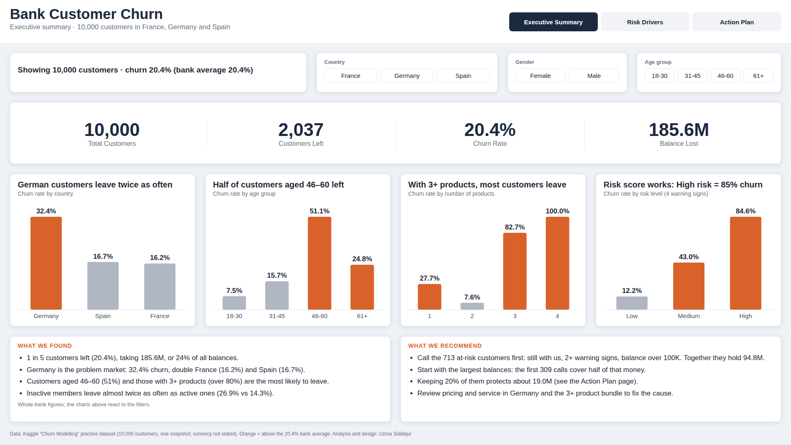
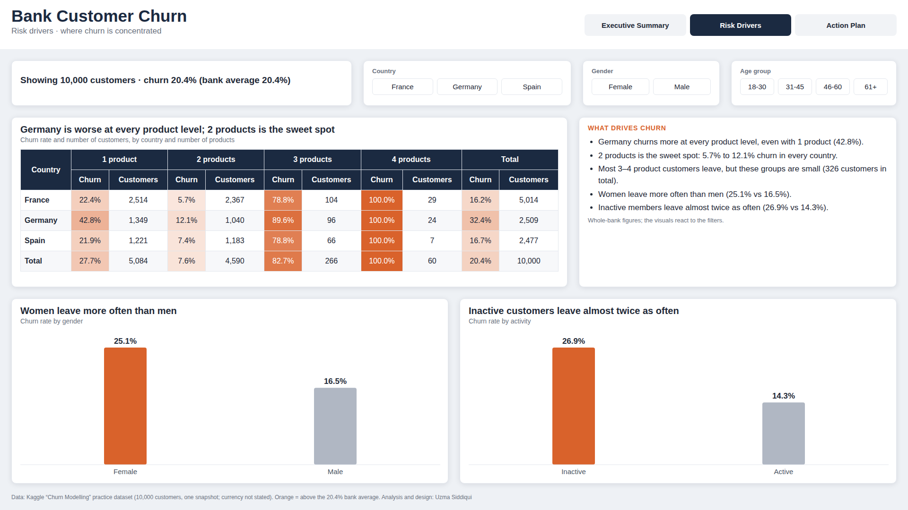
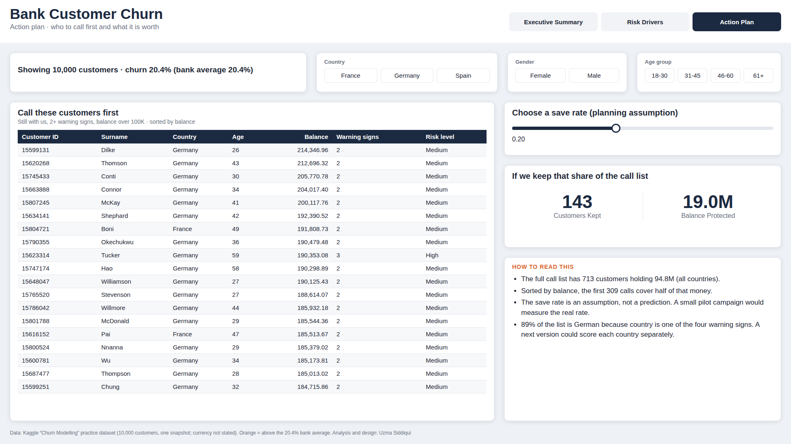
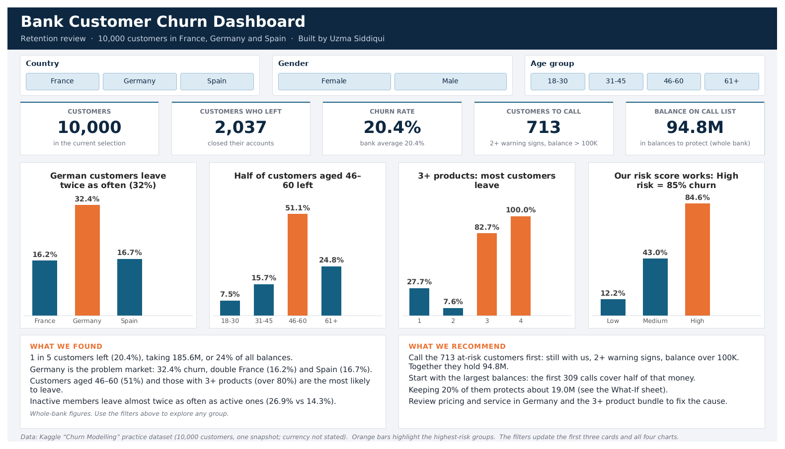
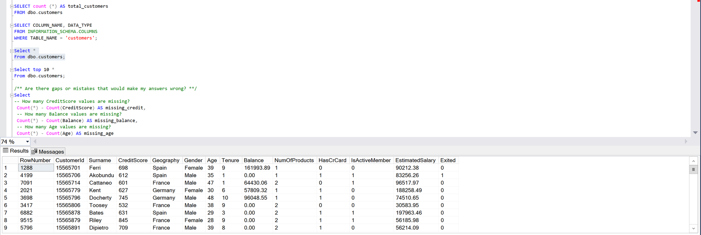

# Bank Customer Churn Analysis

**Who is leaving the bank, why, and who should the retention team call first?**

An end-to-end analysis of 10,000 retail bank customers using **SQL Server, Python, Excel and Power BI**: data quality checks, churn analysis by segment, a simple 4-point risk score, and a prioritized retention call list with a what-if model.



---

## Business problem

A retail bank has lost about one in five of its customers. Leadership wants to know:

1. How many customers are leaving, and how much money goes with them?
2. Which customer groups are most likely to leave?
3. Which current customers should the retention team contact first, and what is that worth?

## Key results

| Metric | Result |
|---|---|
| Customers analyzed | 10,000 |
| Customers who left | 2,037 (**20.4% churn**) |
| Balances held by leavers | **185.6M**, or 24% of all balances |
| Retention call list | **713 customers** holding **94.8M** |
| Calls needed to cover half of that money | 309 (largest balances first) |
| Balance protected at a 20% save rate | about **19.0M** |

## Key findings

| Driver | Churn rate | Compared with |
|---|---|---|
| **Germany** | 32.4% | France 16.2%, Spain 16.7% |
| **Age 46-60** | 51.1% | Age 18-30: 7.5% |
| **3+ products** | 82.7% (3), 100% (4) | 2 products: 7.6% |
| **Inactive members** | 26.9% | Active: 14.3% |
| **Women** | 25.1% | Men: 16.5% |

- **Germany is worse at every product level**, even for customers holding one product (42.8% churn).
- **Two products is the sweet spot**: 5.7% to 12.1% churn in every country.
- **Germans aged 46-60 leave at 67%**, two out of three. The age risk and the Germany risk add together.
- **Leavers hold more money**: about 91K on average versus 73K for customers who stayed. Salary and credit score are almost the same in both groups, so they do not explain churn.

## Risk score

One point for each warning sign: **aged 46-60**, **3+ products**, **inactive**, **based in Germany**.

| Risk level | Points | Customers | Actually left |
|---|---|---|---|
| Low | 0-1 | 7,851 | 12.2% |
| Medium | 2 | 1,778 | 43.0% |
| High | 3-4 | 371 | **84.6%** |

A rule simple enough to explain to any manager separates customers who stay from customers who leave.

## Recommendations

1. **Call the 713 at-risk customers first** (still with the bank, 2+ warning signs, balance over 100K), starting with the largest balances. The first 309 calls cover half of the 94.8M.
2. **Investigate Germany**: churn is double the other markets at every product level (pricing, service, or a local competitor).
3. **Review the 3+ product bundle**, testing changes on a small group first, since only 326 customers hold 3-4 products.
4. **Re-engage inactive customers** through the mobile app, direct deposit or bill payments, one of the cheapest ways to reduce churn.

---

## Workflow and tools

| Step | Tool | What I did | File |
|---|---|---|---|
| 1. Explore and score | **Python** (pandas, matplotlib) | Data quality checks, churn by segment, risk score, call list, charts | [`python/bank_churn_analysis.ipynb`](python/bank_churn_analysis.ipynb) |
| 2. Query and validate | **SQL Server** (T-SQL) | Load data, quality checks, CTEs, `CASE WHEN`, a scored view, window functions (`RANK`, `ROW_NUMBER`, `NTILE`, running totals) | [`sql/churn_analysis.sql`](sql/churn_analysis.sql) |
| 3. Interactive workbook | **Excel** | Structured tables, slicers, `XLOOKUP` customer lookup, dynamic call list, what-if save-rate model | [`excel/Bank_Churn_Dashboard.xlsx`](excel/Bank_Churn_Dashboard.xlsx) |
| 4. Executive report | **Power BI** | Three-page report (Executive Summary, Risk Drivers, Action Plan) with filters, a save-rate slider and a custom theme | [`powerbi/Bank_Churn_Dashboard.pbix`](powerbi/Bank_Churn_Dashboard.pbix) |

The same numbers were reproduced in Python, SQL, Excel and Power BI, so each tool cross-checks the others.

## Dashboards

**Power BI: Risk Drivers**


**Power BI: Action Plan**


**Excel dashboard**


**SQL Server: data load and quality checks**


---

## Repository structure

```
bank-customer-churn-analysis/
├── data/
│   └── Churn_Modelling.csv            # raw dataset (10,000 rows, 14 columns)
├── python/
│   └── bank_churn_analysis.ipynb      # exploration, risk score, call list, charts
├── sql/
│   └── churn_analysis.sql             # SQL Server script, 8 sections
├── excel/
│   └── Bank_Churn_Dashboard.xlsx      # interactive dashboard, call list, what-if model
├── powerbi/
│   ├── Bank_Churn_Dashboard.pbix      # 3-page Power BI report
│   └── ChurnExecutiveTheme.json       # custom report theme
├── outputs/
│   ├── bank_customers_with_risk.csv   # all customers with risk points and level
│   └── call_list.csv                  # 713 customers to call, largest balance first
└── images/                            # dashboard and query screenshots
```

## How to run it

- **Python:** open `python/bank_churn_analysis.ipynb` in Jupyter and run all cells (needs `pandas` and `matplotlib`). It reads `../data/Churn_Modelling.csv` and writes the files in `outputs/`.
- **SQL:** open `sql/churn_analysis.sql` in SQL Server Management Studio, update the `BULK INSERT` file path to where you saved `data/Churn_Modelling.csv`, and run the sections in order.
- **Excel:** open `excel/Bank_Churn_Dashboard.xlsx` (Excel 365 or 2021+ for `XLOOKUP` and dynamic arrays). Use the slicers on the Dashboard sheet, or change the save rate on the What-If sheet.
- **Power BI:** open `powerbi/Bank_Churn_Dashboard.pbix` in Power BI Desktop.

## Dataset

- **Source:** [Churn Modelling, Kaggle](https://www.kaggle.com/datasets/shrutimechlearn/churn-modelling), originally shared as course material by SuperDataScience
- **Size:** 10,000 customers, 14 columns, one snapshot in time; currency is not stated
- **Target:** `Exited` (1 = left the bank, 0 = stayed)
- **License:** listed as "Unknown" on Kaggle; used here for learning and portfolio purposes only

## Limitations

- This is an anonymized public practice dataset, not real Canadian bank data, which is private.
- The analysis shows patterns, not proof of why customers leave. Surveys or exit interviews would be needed to confirm the causes.
- The 20% save rate is a planning assumption, not a prediction. A small pilot campaign would measure the real rate.
- 89% of the call list is German because country is one of the four warning signs. A next version could score each country separately.

---

**Uzma Siddiqui** · Ottawa, ON · [LinkedIn](https://www.linkedin.com/in/uzmasid1)
